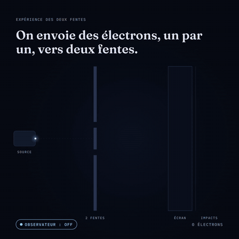

<div align="center">

# L'expérience des deux fentes

**Une simulation interactive de l'expérience des fentes de Young, électron par électron.**

**Français** · [English](README.en.md) · [العربية](README.ar.md)

[**▶ Essayer la démo**](https://lahnabil.github.io/double-slit-experiment/?lang=fr) · [Comment ça marche](#comment-ça-marche)



</div>

---

## L'expérience

On envoie des électrons, **un par un**, vers une plaque percée de deux fentes. Derrière, un écran enregistre où chacun arrive.

1. **Chaque électron frappe l'écran en un seul point**, comme une bille.
2. **Après des milliers d'impacts, des bandes apparaissent** : un motif d'interférence, la signature d'une onde. L'électron s'est comporté comme s'il avait traversé les deux fentes.
3. **On ajoute un détecteur** pour savoir par quelle fente passe chaque électron.
4. **Les bandes disparaissent.** Il ne reste que deux taches, comme pour de simples particules.

Rien n'a changé dans l'expérience, sauf une chose : on a regardé.

## Ce que fait la simulation

- **Mode libre** : réglez le débit (de 1 à 1 000 électrons par seconde), activez ou coupez le détecteur, effacez l'écran.
- **Scénario de 36 s** : une séquence commentée, sans interface, pensée pour être enregistrée et partagée (formats carré 1:1 et portrait 4:5).
- **Trois langues** : français, anglais et arabe (avec mise en page de droite à gauche), y compris les textes de la simulation. La langue suit celle du navigateur, ou se choisit avec `?lang=fr`, `?lang=en` ou `?lang=ar`.
- **Zéro dépendance** : un seul fichier HTML, Canvas 2D, JavaScript natif. Aucun build.

## Comment ça marche

La simulation ne résout pas l'équation de Schrödinger. Elle fait ce qu'un vrai écran de détection montre : **chaque électron arrive à une position tirée au hasard selon la distribution de probabilité prédite par la théorie.** C'est l'accumulation de ces tirages qui fait apparaître le motif.

**Sans détecteur**, la probabilité suit la figure de diffraction de Fraunhofer pour deux fentes :

```
I(u) ∝ cos²(π·k·u) · sinc²(π·b·u)
```

- `cos²(π·k·u)` : les franges d'interférence entre les deux chemins possibles
- `sinc²(π·b·u)` : l'enveloppe de diffraction due à la largeur de chaque fente
- `u` : la position sur l'écran, normalisée entre -1 et 1

**Avec détecteur**, l'information « par quelle fente » détruit la cohérence entre les deux chemins. Les probabilités ne s'additionnent plus en amplitude mais en intensité : le terme d'interférence disparaît, il reste deux bosses, une par fente.

Chaque position est tirée par **échantillonnage par inversion de la fonction de répartition** (CDF précalculée sur 2 400 points, recherche dichotomique). Le générateur aléatoire est seedé (`mulberry32`) : le scénario est identique à chaque lecture.

### Limites, en toute transparence

- Les paramètres (écart entre fentes, longueur d'onde) sont choisis pour la lisibilité, pas mesurés sur un dispositif réel.
- En champ lointain réel, les deux bosses du mode « observé » se recouvrent davantage. Elles sont ici séparées pour rendre le contraste visible.
- « L'électron passe par les deux fentes à la fois » est une image. Ce que l'expérience établit, c'est qu'il se comporte comme une onde tant qu'aucune information sur son chemin n'existe. Ce qui se passe « vraiment » dépend de l'interprétation de la mécanique quantique, et le débat reste ouvert.

## Lancer en local

Aucune installation. Ouvrez simplement `index.html` dans un navigateur, ou servez le dossier :

```bash
python -m http.server 8000
# puis http://localhost:8000
```

## Structure

```
.
├── index.html               # la simulation complète (HTML + CSS + JS, 3 langues)
├── README.md                # documentation en français
├── README.en.md             # documentation en anglais
├── README.ar.md             # documentation en arabe
├── assets/
│   ├── preview.gif          # aperçu du README
│   └── og-image.png         # image de partage (LinkedIn, X…)
└── LICENSE
```

## Pour aller plus loin

- Richard Feynman, *Cours de physique de Feynman*, tome 3, chapitre 1 : l'expérience décrite comme « le seul mystère » de la mécanique quantique.
- Tonomura et al. (1989), *Demonstration of single-electron buildup of an interference pattern*, American Journal of Physics : l'expérience réalisée électron par électron, dont cette simulation reproduit le principe.

## Crédits

Conçu par **[Nabil Lahlalia](https://github.com/LahNabil)**, fondateur de [WivoAgency](https://wivoagency.com), et développé avec l'aide de Claude (Anthropic).

Je ne suis pas physicien : ce projet est né d'une curiosité. Si vous repérez une erreur ou une approximation trompeuse, [ouvrez une issue](https://github.com/LahNabil/double-slit-experiment/issues), j'apprendrai quelque chose.

Licence [MIT](LICENSE).

